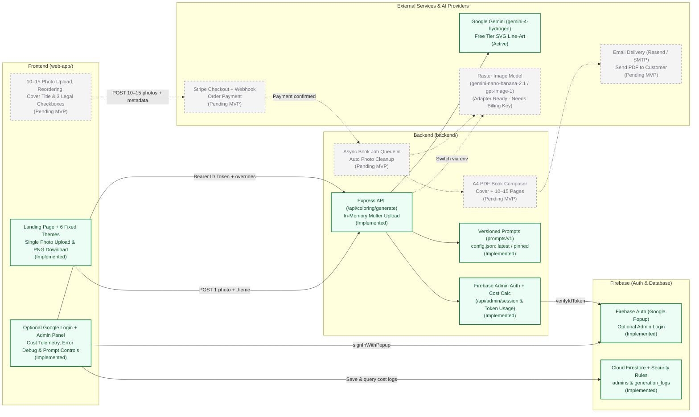

# ColoraStoria

Web app that turns personal photos into printable coloring-book pages using a server-side, multi-provider AI backend.

## Repository Layout
- `AGENTS.md` — Template engineering guidelines enforcing strict Interface vs. Implementation module separation and wiki maintenance.
- `docs/WIKI.md` — Plain-language Italian technical wiki explaining all tools, libraries, security controls, and architectural choices.
- `shared/` — Cross-stack TypeScript domain contracts (`shared/types/`) and single-source-of-truth limits/themes (`shared/config/`) shared by `backend/` and `web-app/`.
- `web-app/` — React + TypeScript + Tailwind CSS frontend with domain modules under `web-app/src/modules/`, self-hosted `@fontsource` fonts, and real-URL legal routes (`web-app/README.md`).
- `backend/` — Express + TypeScript API server with domain modules under `backend/src/modules/` and Zod startup env validation (`backend/README.md`).
- `tests/` — Native Node test runner suite (`node --test`) verifying upload validation, auth/providers, and config/rules consistency.
- `Dockerfile` & `.dockerignore` — Multi-stage non-root production container (`node:24-slim`).
- `.github/workflows/ci.yml` — Automated CI running `lint`, `test`, `build`, and `npm audit`.
- `eslint.config.mjs` — Enforces module boundaries (`no-restricted-imports`) and Firestore security rules checks.
- `prompts/` — Versioned prompt library and `config.json` version selector (`prompts/README.md`).
- `pricing/` — AI model cost estimates for Standard and Batch APIs (`pricing/ai/image-generation-costs.md`).
- `infra/` — Infrastructure as Code (Terraform) to automatically provision Cloud Run, Artifact Registry, Secret Manager, Firestore, and Firebase Auth (`infra/README.md`).
- `firebase-blueprint.json` & `firestore.rules` — Firestore schema blueprint and hardened security rules.
- `server.ts` — Root entry point delegating to `backend/server.ts`.
- `.env.example` — Required server-side environment variables.

## Quick Start
```bash
npm install
npm run dev
```

## Environment Variables
Copy `.env.example` or set secrets in your hosting environment:
- `AI_PROVIDER=gemini` (`gemini` or `openai`)
- `PROMPT_VERSION` — Optional override (defaults to `prompts/config.json` `activeVersion: "latest"`)
- `GEMINI_API_KEY` — Required for the default Gemini provider
- `GEMINI_MODEL=gemini-nano-banana-2.1` — Default high-quality raster image model (supports face likeness)
- `OPENAI_API_KEY` / `OPENAI_MODEL=gpt-image-1` — Optional OpenAI configuration
- `ADMIN_EMAILS` — Optional comma-separated verified Google emails allowed to view Admin telemetry (empty = none; prefer setting Firebase custom claim `{ admin: true }` via `scripts/set-admin-claim.ts`)
- `TURNSTILE_SECRET_KEY` / `VITE_TURNSTILE_SITE_KEY` — Optional free Cloudflare Turnstile anti-bot keys (recommended before public deploy)
- `APP_CHECK_ENABLED` — Set to `true` if using Firebase App Check instead of Turnstile

## Architecture & MVP Roadmap

Solid boxes show what is **implemented and active** today; dashed grey boxes show what is **still pending for the full MVP**.



### Status Summary
- **Implemented:** Single-page landing UI, 6 fixed themes, single-photo validation & upload, PNG export, Express backend (`backend/`), versioned prompt library (`prompts/v1`), optional Firebase Google Login (`signInWithPopup`) + server-side `firebase-admin` verification, Admin cost/token telemetry & full error diagnostics, Firestore `generation_logs` persistence with deployed security rules, and active `gemini-4-hydrogen` adapter (`OpenAIColoringProvider` & Gemini raster mode pre-wired via env).
- **Pending for Final MVP:** Multi-photo upload (`10–15` photos with reorder), custom cover title, email input & 3 mandatory legal checkboxes, Stripe Checkout + webhook verification, billing-enabled raster image model (`gemini-nano-banana-2.1`) for high facial likeness, A4 PDF generation, automated email delivery, and order confirmation screen.

## Scripts
- `npm run dev` — Starts Express + Vite dev server (`NODE_ENV=development`) on port `3000`.
- `npm run build` — Builds `web-app/` into `dist/`.
- `npm run start` — Runs the production server (`NODE_ENV=production`) on port `3000`.
- `npm run lint` — Runs TypeScript checks (`tsc --noEmit`) and ESLint architectural & Firestore rules checks (`eslint .`).
- `npm test` — Runs unit and theme/rules consistency tests (`node --test tests/*.test.ts`).
- `npm run prompts:sync` — Regenerates `manual-test.json` inside every `prompts/v*` folder.

## Deploy su Cloud Run (Free Tier & Container)

The repository includes a multi-stage `Dockerfile` (`node:24-slim`, production-only `npm ci --omit=dev`, non-root `USER node`, `PORT=8080`).

1. **Secrets in Secret Manager (never plain env vars)**:
   Store `GEMINI_API_KEY` (and optionally `TURNSTILE_SECRET_KEY` / `OPENAI_API_KEY`) in **Google Cloud Secret Manager** and grant the Cloud Run runtime service account `roles/secretmanager.secretAccessor`.
2. **Build & Deploy staying within Cloud Run Free Tier**:
   ```bash
   gcloud run deploy colorastoria \
     --source . \
     --region europe-west1 \
     --allow-unauthenticated \
     --min-instances 0 \
     --max-instances 2 \
     --concurrency 10 \
     --cpu 1 \
     --memory 512Mi \
     --set-env-vars "NODE_ENV=production,AI_PROVIDER=gemini,GEMINI_MODEL=gemini-nano-banana-2.1" \
     --set-secrets "GEMINI_API_KEY=GEMINI_API_KEY:latest,TURNSTILE_SECRET_KEY=TURNSTILE_SECRET_KEY:latest"
   ```
   - `--min-instances 0` keeps idle costs at `$0` (Cloud Run Free Tier includes 2M requests, 360k GB-seconds, and 180k vCPU-seconds/month).
   - `--max-instances 2 --concurrency 10` caps memory usage (`multer.memoryStorage()` buffers) and prevents surprise scaling bills.
   - If using Cloudflare Turnstile, bake `VITE_TURNSTILE_SITE_KEY` at build time (via `--build-env-vars` or Docker `--build-arg VITE_TURNSTILE_SITE_KEY=...`).
2. **GCP Billing Budget Alerts**:
   In **GCP Billing > Budgets & alerts**, create a monthly budget (e.g. `€10`) with email notifications at `50%`, `90%`, and `100%` of spend.
3. **Restrict API Keys in Google Cloud Console (`APIs & Services > Credentials`)**:
   - **Firebase Web API Key** (present in public `firebase-applet-config.json`): restrict **Application restrictions** to **HTTP referrers** matching your production/preview domains (`https://your-domain/*`) and restrict **API restrictions** strictly to **Identity Toolkit API**, **Token Service API**, and **Cloud Firestore API**.
   - **Gemini API Key (`GEMINI_API_KEY`)**: restrict **API restrictions** strictly to **Generative Language API** (do not reuse keys across unrelated GCP services).
4. **Anti-Bot Protection on `POST /api/coloring/generate`**:
   Server IP rate-limiting (`express-rate-limit` with `app.set('trust proxy', 1)`) is active by default. Before opening the app publicly with billing enabled, enable **Cloudflare Turnstile** (`TURNSTILE_SECRET_KEY` + `VITE_TURNSTILE_SITE_KEY` at build time) or **Firebase App Check** (`APP_CHECK_ENABLED=true`).
5. **Granting Admin Access (`custom claim`)**:
   Run the one-time Firebase Admin SDK script instead of hardcoding admin emails:
   ```bash
   npx tsx scripts/set-admin-claim.ts admin@yourdomain.com
   ```
   Then sign out and sign in again to refresh the ID token (`firestore.rules` checks `request.auth.token.admin == true && request.auth.token.email_verified == true`).
