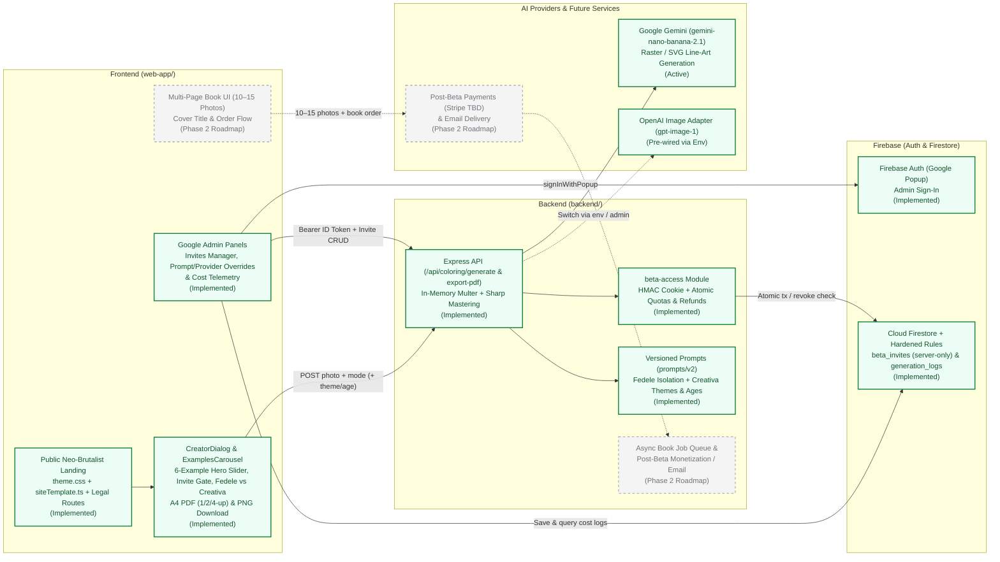

# ColoraStoria

Web app that turns personal photos into printable coloring-book pages using a server-side, multi-provider AI backend.

Currently operating in **Phase 1 (Private Beta)** for instant single-page generation and print-ready A4 PDF export, gated by personal invite codes and per-user quotas. See [docs/REQUIREMENTS.md](docs/REQUIREMENTS.md) for the versioned product specification and Phase 2 roadmap.

## Repository Layout
- `AGENTS.md` — Engineering guidelines enforcing Interface vs. Implementation module separation and mandatory Wiki/Requirements maintenance.
- `docs/REQUIREMENTS.md` — Versioned Product Requirements Wiki in Italian (`v1.0.0`: Phase 1 active specs, non-functional security/cost rules, Phase 2 roadmap, and changelog).
- `docs/WIKI.md` — Plain-language Italian technical wiki explaining all tools, libraries, security controls, and architectural choices.
- `shared/` — Cross-stack TypeScript domain contracts (`shared/types/`) and single-source-of-truth limits/modes/themes/ages (`shared/config/`) shared by `backend/` and `web-app/`.
- `web-app/` — React + TypeScript + Tailwind CSS frontend with a neo-brutalist themeable UI (`theme.css`, `siteTemplate.ts`, `CreatorDialog`, `AdminInvitesPanel`), domain modules under `web-app/src/modules/`, self-hosted `@fontsource` fonts, and real-URL legal routes (`web-app/README.md`).
- `backend/` — Express + TypeScript API server with domain modules under `backend/src/modules/` (including `beta-access` invite quotas and `print-pdf` A4 mastering) and Zod startup env validation (`backend/README.md`).
- `tests/` — Native Node test runner suite (`node --test`) verifying upload validation, auth/providers, beta-access quotas/revocation, prompt mode/theme/age combinations, PDF export, and config/rules consistency.
- `Dockerfile` & `.dockerignore` — Multi-stage non-root production container (`node:24-slim`).
- `.github/workflows/ci.yml` — Automated CI running `lint`, `test`, `build`, and `npm audit --audit-level=high`.
- `eslint.config.mjs` — Enforces module boundaries (`no-restricted-imports`) and Firestore security rules checks.
- `prompts/` — Versioned prompt library (`v2` multi-mode/age + `v1` fallback) and `config.json` version selector (`prompts/README.md`).
- `pricing/` — AI model cost estimates for Standard and Batch APIs (`pricing/ai/image-generation-costs.md`).
- `infra/` — Infrastructure as Code (Terraform) to automatically provision Cloud Run, Artifact Registry, Secret Manager, Firestore, and Firebase Auth (`infra/README.md`).
- `scripts/` — One-time admin utilities (`set-admin-claim.ts`, `manage-invites.ts`).
- `firebase-blueprint.json` & `firestore.rules` — Firestore schema blueprint and hardened security rules.
- `server.ts` — Root entry point delegating to `backend/server.ts`.
- `.env.example` — Required and optional server-side environment variables.

## Quick Start
```bash
npm install
npm run dev
```

## Environment Variables
Copy `.env.example` or set secrets in Secret Manager / hosting environment:
- `AI_PROVIDER=gemini` (`gemini` or `openai`)
- `PROMPT_VERSION` — Optional override (defaults to `prompts/config.json` `activeVersion: "latest"` -> `v2`)
- `GEMINI_API_KEY` — Required for the default Gemini provider
- `GEMINI_MODEL=gemini-nano-banana-2.1` — Default high-quality raster image model (supports likeness across people, pets, toys, and landscapes)
- `OPENAI_API_KEY` / `OPENAI_MODEL=gpt-image-1` — Optional OpenAI configuration
- `ADMIN_EMAILS` — Optional comma-separated verified Google emails allowed Admin diagnostics & invite management (empty = none; prefer also setting Firebase custom claim `{ admin: true }` via `scripts/set-admin-claim.ts`)
- `BETA_INVITE_REQUIRED=false` — Set `true` to gate generation and PDF export behind personal Firestore invite codes (`beta_invites`) while keeping the landing page public
- `BETA_SESSION_SECRET` — HMAC-SHA256 signing secret (>= 16 chars required in production when `BETA_INVITE_REQUIRED=true`) for `HttpOnly` invite session cookies (`cs_invite`)
- `TURNSTILE_SECRET_KEY` / `VITE_TURNSTILE_SITE_KEY` — Optional free Cloudflare Turnstile anti-bot keys
- `APP_CHECK_ENABLED` — Set `true` if using Firebase App Check instead of Turnstile
- `BOT_PROTECTION_REQUIRED` — Set `true`/`false` to explicitly require or disable anti-bot verification

## Architecture & Product Phases

Solid boxes show **Phase 1 (Implemented & Active in Private Beta)**; dashed grey boxes show **Phase 2 (Future Roadmap)**.



### Status Summary
- **Implemented (Phase 1 — Private Beta):** Neo-brutalist themeable landing UI (`theme.css`, `siteTemplate.ts`, fixed-position 6-example `ExamplesCarousel` hero slider, `CreatorDialog`, 4 procedural canvas samples), real-URL legal routes, **Fedele alla foto** (faithful outlines with zero theme leakage) vs **Creativa** (6 themes + 4 age groups exclusive to creative mode), single-photo validation (`JPG/PNG/WebP/AVIF`) & EXIF/resize (`<=1280px`), print-ready A4 PDF (`1-up`/`2-up`/`4-up` grayscale at 300 DPI) & PNG download, personal Firestore invite access & atomic quotas (`beta-access`), Google Admin panel (`AdminInvitesPanel`, cost telemetry, prompt/provider overrides, `generation_logs`), `prompts/v2`, active `gemini-nano-banana-2.1` provider (`OpenAIColoringProvider` ready via env), and full Terraform IaC (`infra/`).
- **Planned for Phase 2 (Future Roadmap):** Multi-page coloring book composition (`10–15` photos + cover), post-beta monetization model to be validated after beta feedback (credit packs / pay-per-page / subscription), async job queue & automated email delivery, and final commercial/legal copy alignment.

## Scripts
- `npm run dev` — Starts Express + Vite dev server (`NODE_ENV=development`) on port `3000`.
- `npm run build` — Builds `web-app/` into `dist/`.
- `npm run start` — Runs the production server (`NODE_ENV=production`) on port `3000`.
- `npm run lint` — Runs TypeScript checks (`tsc --noEmit`) and ESLint architectural & Firestore rules checks (`eslint .`).
- `npm test` — Runs all unit, beta-access, PDF, image validation, prompt combination, and consistency tests (`node --test tests/*.test.ts`).
- `npm run prompts:sync` — Regenerates `manual-test.json` inside every `prompts/v*` folder.

## Deploy on Cloud Run (Terraform Free Tier & Container)

The repository includes full Terraform IaC (`infra/`) and a multi-stage `Dockerfile` (`node:24-slim`, production-only `npm ci --omit=dev`, non-root `USER node`, `PORT=8080`):

1. **Provision with Terraform (`infra/`)**:
   Configures Cloud Run v2 (`min_instances = 0`, `max_instances = 2`, `concurrency = 10`, `512Mi`), Secret Manager (`GEMINI_API_KEY`, `BETA_SESSION_SECRET`, optional `TURNSTILE_SECRET_KEY`), Firestore Native DB, hardened `firestore.rules`, Firebase Web App, Identity Platform, and least-privilege Service Account. See [infra/README.md](infra/README.md).
2. **Build & Roll Out Updates**:
   ```bash
   IMAGE="europe-west1-docker.pkg.dev/<PROJECT_ID>/colorastoria-repo/colorastoria:latest"
   gcloud builds submit --project="<PROJECT_ID>" --region=europe-west1 --tag="$IMAGE" .
   gcloud run services update colorastoria --project="<PROJECT_ID>" --region=europe-west1 --image="$IMAGE"
   ```
3. **Seed Invites & Admin Claim**:
   ```bash
   npx tsx scripts/manage-invites.ts create --label "Marco" --code MARCO-BETA --max 50
   npx tsx scripts/set-admin-claim.ts admin@yourdomain.com
   ```
4. **GCP Console Safety Defaults**:
   Keep billing budget alerts configured, restrict `GEMINI_API_KEY` solely to *Generative Language API*, and restrict the public Firebase Web API key to your Cloud Run / custom domains.
