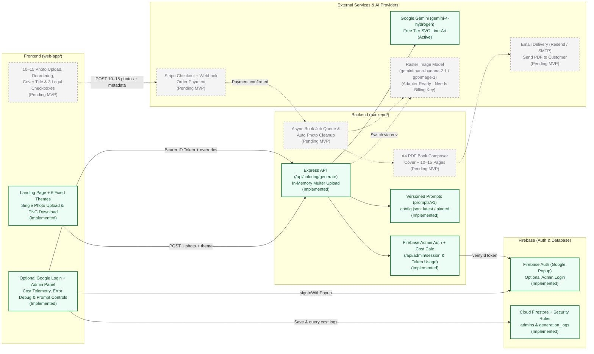

# ColoraStoria

Web app that turns personal photos into printable coloring-book pages using a server-side, multi-provider AI backend.

## Repository Layout
- `web-app/` — React + TypeScript + Tailwind CSS frontend (`web-app/README.md`).
- `backend/` — Express + TypeScript API server with pluggable AI providers, Firebase Admin verification, and token cost calculation (`backend/README.md`).
- `prompts/` — Versioned prompt library and `config.json` version selector (`prompts/README.md`).
- `pricing/` — AI model cost estimates for Standard and Batch APIs (`pricing/ai/image-generation-costs.md`).
- `firebase-blueprint.json` & `firestore.rules` — Firestore schema blueprint and hardened security rules.
- `server.ts` — Root entry point delegating to `backend/server.ts`.
- `.env.example` — Required server-side environment variables.

## Quick Start
```bash
npm install
npm run dev
```

## Environment Variables
Copy `.env.example` or set secrets in your hosting environment:
- `AI_PROVIDER=gemini` (`gemini` or `openai`)
- `PROMPT_VERSION` — Optional override (defaults to `prompts/config.json` `activeVersion: "latest"`)
- `GEMINI_API_KEY` — Required for the default Gemini provider
- `GEMINI_MODEL=gemini-4-hydrogen` — Free tier default model
- `OPENAI_API_KEY` / `OPENAI_MODEL=gpt-image-1` — Optional OpenAI configuration
- `ADMIN_EMAILS=marco.fierimonte@gmail.com` — Comma-separated verified Google emails allowed to view Admin telemetry

## Architecture & MVP Roadmap

Solid boxes show what is **implemented and active** today; dashed grey boxes show what is **still pending for the full MVP**.



### Status Summary
- **Implemented:** Single-page landing UI, 6 fixed themes, single-photo validation & upload, PNG export, Express backend (`backend/`), versioned prompt library (`prompts/v1`), optional Firebase Google Login (`signInWithPopup`) + server-side `firebase-admin` verification, Admin cost/token telemetry & full error diagnostics, Firestore `generation_logs` persistence with deployed security rules, and active `gemini-4-hydrogen` adapter (`OpenAIColoringProvider` & Gemini raster mode pre-wired via env).
- **Pending for Final MVP:** Multi-photo upload (`10–15` photos with reorder), custom cover title, email input & 3 mandatory legal checkboxes, Stripe Checkout + webhook verification, billing-enabled raster image model (`gemini-nano-banana-2.1`) for high facial likeness, A4 PDF generation, automated email delivery, and order confirmation screen.

## Scripts
- `npm run dev` — Starts Express + Vite dev server on port `3000`.
- `npm run build` — Builds `web-app/` into `dist/`.
- `npm run start` — Runs the production server on port `3000`.
- `npm run lint` — Runs TypeScript checks (`tsc --noEmit`).
- `npm run prompts:sync` — Regenerates `manual-test.json` inside every `prompts/v*` folder.
